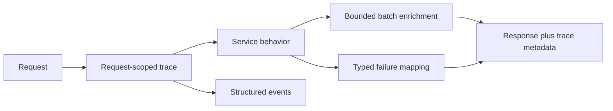

# Service Refactoring Notes

An engineering case study by Kallas Lima: improving an existing Python service without losing its externally observable behavior.

This exercise began with a supplied application. My contribution was a sequence of refactors across authentication, database access, error handling, observability, test isolation, and the build graph. This repository contains my explanation of that work. It intentionally packages the engineering reasoning rather than redistributing the supplied application.

## 1. Migrate password storage without locking users out

The original path used a legacy password digest. I introduced a salted, parameterized scrypt representation with explicit verification and an upgrade decision. A successful legacy login can upgrade the stored value; unsuccessful authentication cannot. The update compares against the old digest so a concurrent password change is not overwritten by a stale login.

Configuration validation also matters at the write boundary: token-signing configuration is checked before creating an account, avoiding an account that was persisted even though the response could never issue a usable session.

The important review questions are the upgrade path, compatibility, malformed stored values, bounded hash parameters, and concurrent updates. A new hash algorithm alone would not settle those behaviors.

## 2. Replace per-post reads with bounded aggregation

Post serialization needed like counts, viewer-like state, and comment counts. Loading those facts independently for every post made the number of database round trips grow with the response size.

I moved enrichment into a batch loader. It deduplicates identifiers, skips SQL for an empty input, splits work into chunks of 500, and runs two aggregates per chunk: one for likes and viewer state, and one for comments. Separate aggregates prevent a likes-by-comments join from multiplying counts. Serialization preserves the requested order and handles missing related data.

For N distinct identifiers, this loader performs 2 × ceil(N / 500) aggregate queries. That is a bound for this enrichment operation, not for the entire endpoint. No new production latency or traffic claim is attached to this case study.

## 3. Give failures a stable public shape

Expected application failures map to explicit gRPC status categories. Reviewed legacy failures retain a controlled mapping during the transition. Unexpected exceptions take a generic public path instead of exposing arbitrary internal exception details.

Request-scoped context carries the trace identifier and method. The interceptor emits structured events with status and duration and returns trace metadata. Server-side trace generation and ContextVar scoping keep concurrent requests from borrowing each other's context.

## 4. Make validation independent and repeatable

Database tests need isolated records and cleanup boundaries; browser workers need distinct fixture ownership. Shared credentials, mutable global state, and worker collisions can make a passing run depend on execution order. I separated those fixtures and strengthened the tests around the changed contracts.

I also updated the affected-project build flow so changes consider relevant upstream and downstream projects. Faster feedback is useful only when the dependency graph still includes the consumers that can break.

## What this work shows

- Incremental migration of a security-sensitive path with compatibility and concurrency constraints.
- SQL cardinality reasoning and a concrete query-count bound.
- Stable service contracts, useful diagnostics, and controlled public errors.
- Attention to test isolation and the build graph around a change.

The work was completed as five refactor commits in a larger supplied codebase. This case study does not claim authorship of that platform. The source submission is retained privately; the prose and diagram here are newly prepared for portfolio review.
